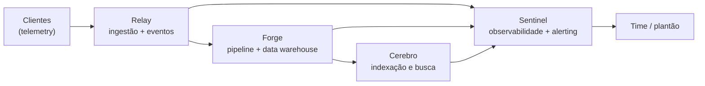

# Desafio 2: Playbook de IA Operacional da Aegis

Desafio prático da pós-graduação **AIOps e IA na Engenharia de Cloud**, no capítulo de Engenharia de Prompt e Contexto.

A proposta: a Aegis decidiu que o uso de IA pelo time de engenharia não pode mais ser ad-hoc, cada um com seu prompt solto no histórico do chat. O Nick Fury quer um **playbook de IA operacional**: uma biblioteca de prompts versionada, testada e tratada como código, que qualquer engenheiro possa pegar e confiar.

São 10 checkpoints em que a biblioteca nasce, amadurece e termina como **repositório testado em pipeline**. A complexidade cresce: os primeiros produzem um prompt cada, o sétimo transforma a coleção em repositório, e os três últimos cobram engenharia de teste e decisão de design.

Duas regras de método valem para o desafio inteiro:

- **Todo prompt é parametrizável**: recebe os dados variáveis por parâmetro, para ser reusável, e não serve a um caso só.
- **A criação é por meta-prompting**: a IA é dirigida para gerar e refinar o prompt, em vez de o texto ser redigido na mão. O meta-prompt não é entregável; o que entra na biblioteca é o prompt final, com curadoria.

> Todos os dados, sistemas e pessoas do cenário são fictícios. Nada aqui vem de ambiente real. As decisões de sanitização, ainda assim, foram tomadas como se os dados fossem de produção: está registrado no Checkpoint 03.

---

## O repositório do playbook

**https://github.com/brianmonteiro54/prompt-registry**

O playbook é um **repositório git próprio**, baseado no template [`fabricioveronez/prompt-registry`](https://github.com/fabricioveronez/prompt-registry), e vive em `prompt-registry/` dentro desta pasta. Ele está no `.gitignore` do repositório da pós de propósito: sendo um repositório independente, versioná-lo aqui criaria um gitlink vazio e os arquivos não apareceriam na página web. A decisão está explicada no Checkpoint 07.

---

## O cenário: Aegis

Empresa fictícia de observabilidade, com um SaaS de observabilidade e resposta a incidentes. Outras empresas plugam seus ambientes nela e passam a enxergar métricas, logs e alertas num lugar só.

**Os quatro sistemas**

| Sistema | O que é |
|---|---|
| **Relay** | Barramento de eventos assíncrono e borda de ingestão. Todo o telemetry dos clientes entra por ele |
| **Forge** | Pipeline de dados e data warehouse, onde o telemetry vira série temporal e tabela consultável |
| **Sentinel** | Produto core de observabilidade e alerting, o que o cliente de fato usa |
| **Cerebro** | Sistema de indexação e busca, o que acha a agulha no palheiro de logs |



**Pessoas e papéis.** Cada checkpoint chega por uma pessoa diferente, e isso muda o que o prompt precisa produzir.

Tony Stark (CTO), Pepper Potts (CEO, lê tudo pela ótica de custo), Carol Danvers (Head of Product), Steve Rogers (staff engineer, autor do legado), Natasha Romanoff (segurança e compliance), Bruce Banner (engenharia de dados), Sam Wilson (lidera SRE e o plantão), Nick Fury (diretor de operações, cobra previsibilidade).

---

## Os 10 checkpoints

| # | Checkpoint | Entrega |
|---|---|---|
| [01](./Checkpoint%2001.md) | O primeiro prompt do playbook | `triagem-de-pods`: triagem de saúde de pods a partir de snapshot de `kubectl` |
| [02](./Checkpoint%2002.md) | Padronizando as notas de triagem | `nota-de-triagem`: alerta cru vira nota padronizada de 5 rótulos |
| [03](./Checkpoint%2003.md) | Causa-raiz da degradação no Cerebro | `causa-raiz`: cruza config, métricas e logs até a causa |
| [04](./Checkpoint%2004.md) | Segurando a sobrecarga do Relay | `estrategia-backpressure`: compara caminhos antes de recomendar |
| [05](./Checkpoint%2005.md) | Migrando o Forge de lote para tempo real | **cadeia de 3 prompts**, cada elo recebendo a saída do anterior |
| [06](./Checkpoint%2006.md) | Endurecendo a NetworkPolicy do Sentinel | **par gerador/revisor** com 4 rodadas de verificação e refino |
| [07](./Checkpoint%2007.md) | A biblioteca vira código | repositório a partir do template, 9 prompts migrados |
| [08](./Checkpoint%2008.md) | Testes determinísticos com promptfoo | 3 suítes executadas de verdade, com achados reais |
| [09](./Checkpoint%2009.md) | Gate de qualidade com LLM-as-judge | rubrica de 4 critérios e juiz calibrado contra pontuação humana |
| [10](./Checkpoint%2010.md) | O playbook em produção contínua | cobertura em 9 de 9 e pipeline em GitHub Actions |

---

## Os 9 prompts da biblioteca

Todos em `devops/` no repositório do playbook, cada um com `prompt.md`, `README.md` e `promptfooconfig.yaml`.

| Prompt | Versão | Nasceu em | Parâmetros |
|---|:---:|:---:|---|
| `triagem-de-pods` | 1.0.1 | CP01 | `snapshot` |
| `nota-de-triagem` | 1.0.0 | CP02 | `alerta_cru`, `mapa_escalacao` |
| `causa-raiz` | 1.0.0 | CP03 | `config`, `metricas`, `logs` |
| `estrategia-backpressure` | 1.0.0 | CP04 | `estado_atual`, `restricoes`, `opcoes_candidatas` |
| `diagnostico-de-acoplamento` | 1.0.0 | CP05 | `estado_atual`, `requisitos` |
| `plano-de-migracao-faseado` | 1.0.0 | CP05 | `diagnostico`, `requisitos` |
| `detalhamento-de-fase` | 1.0.0 | CP05 | `plano`, `fase_escolhida`, `requisitos` |
| `networkpolicy-sentinel` | 1.0.0 | CP06 | `politica`, `regras_do_padrao`, `mapa_de_servicos` |
| `revisao-de-networkpolicy` | 1.0.1 | CP06 | `politica`, `regras_do_padrao`, `mapa_de_servicos` |

Dois pares com dependência entre si, documentada no `CLAUDE.md` do playbook:

- **Cadeia (CP05):** `diagnostico-de-acoplamento` → `plano-de-migracao-faseado` → `detalhamento-de-fase`. Cada elo consome a saída integral do anterior.
- **Gerador/revisor (CP06):** `networkpolicy-sentinel` produz, `revisao-de-networkpolicy` critica. Nenhum dos dois corrige o que o outro faz.

---

## Cobertura de teste

| Prompt | Casos × providers | Tipo de verificação |
|---|:---:|---|
| `nota-de-triagem` | 6 | determinística |
| `triagem-de-pods` | 6 | determinística |
| `revisao-de-networkpolicy` | 6 | determinística, 3 casos |
| `detalhamento-de-fase` | 4 | determinística, 2 casos |
| `networkpolicy-sentinel` | 2 | determinística + semântica sobre o YAML |
| `estrategia-backpressure` | 2 | determinística, inclui a aritmética |
| `diagnostico-de-acoplamento` | 2 | determinística, inclui regra de ordenação |
| `plano-de-migracao-faseado` | 2 | determinística, testa o encaixe da cadeia |
| `causa-raiz` | 1 | juiz com rubrica, calibrado |
| **Total** | **31** | 30 determinísticos, 1 por julgamento |

Uma execução completa custa **US$ 0,269** e leva **3,4 minutos**. O gate reprova **regressão**, não imperfeição: 8 dos 31 casos falham hoje de forma documentada em `avaliacao/baseline.json`, e aceitar uma falha nova exige commit. O desenho e as alternativas descartadas estão no Checkpoint 10.

---

## Modelos usados

| Onde | Modelo | Por quê |
|---|---|---|
| CP01 a CP05 | Gemini Pro, raciocínio estendido | tarefas de correlação e decisão, que dependem de cadeia longa |
| CP06 | Claude Opus | par gerador/revisor em 4 rodadas na mesma sessão |
| CP08 a CP10, execução | `openai:gpt-4o-mini` e `google:gemini-3.5-flash` | dois fornecedores de propósito: divergência entre eles é sinal de prompt frágil |
| CP09, juiz | `google:gemini-3.5-flash` com raciocínio ligado | escolhido por medição entre três candidatos, dois reprovados na calibração |

> Nos checkpoints 01 a 06 o identificador é o nome do produto como exposto na interface, não um id versionado de API: a execução foi por chat. Do 08 em diante é por API e os identificadores são versionados e reproduzíveis.

---

## O que a suíte encontrou

Os três últimos checkpoints não produziram selo verde, produziram achados. Os principais:

**Defeitos de prompt**, encontrados por teste e não por leitura: regra de severidade que o modelo barato não aplica, cerca de bloco de código numa saída que promete YAML colável, risco silencioso ordenado depois do visível, classificação fabricada para etapas que o insumo não descreve, fase inexistente detalhada como se existisse.

**Defeitos nos meus próprios testes**: quatro bugs de assert no CP08, dois limites operacionais fixados antes de medir, uma rubrica sobreajustada aos exemplos de calibração, e um gate que passava quando a avaliação não conseguia rodar.

**Comportamentos de plataforma que quebram pipeline sem ninguém tocar em prompt**: modelo descontinuado no meio do trabalho, `temperature` descartada em silêncio por uma família de modelos, raciocínio que não pode ser desligado, 503 mascarado como erro de conteúdo, e cota de free tier como limite real do CI.

**O achado mais útil foi contra mim.** Na calibração do Checkpoint 09 o juiz discordou da minha nota, fui conferir o texto e **o juiz estava certo**: eu havia sido leniente. Corrigir a referência humana inverteu o ranking dos juízes: o modelo que parecia perfeito só concordava comigo porque repetia a minha leniência.

---

## Como rodar

Requer Node ≥ 22.22 e as chaves dos provedores em variável de ambiente.

```bash
cd prompt-registry
npm ci

# verificações sem custo: estrutura, frontmatter, parâmetros, configs
npm run verificar

# suíte completa (chama modelo, custa ~US$ 0,27)
export OPENAI_API_KEY=...
export GOOGLE_API_KEY=...
npm run avaliar

# calibração do juiz de causa-raiz
npm run calibrar
```

O pipeline em `.github/workflows/avaliacao.yml` roda isso a cada pull request e push na `main`, comenta o resultado no PR e falha o build quando um prompt regride.

---

## Estrutura

```
Desafio 2 - Playbook de IA Operacional/
├── README.md                 # este arquivo
├── Checkpoint 01.md          # triagem-de-pods
├── Checkpoint 02.md          # nota-de-triagem
├── Checkpoint 03.md          # causa-raiz
├── Checkpoint 04.md          # estrategia-backpressure
├── Checkpoint 05.md          # a cadeia de 3 elos
├── Checkpoint 06.md          # o par gerador/revisor
├── Checkpoint 07.md          # a biblioteca vira repositório
├── Checkpoint 08.md          # testes determinísticos
├── Checkpoint 09.md          # LLM-as-judge e calibração
├── Checkpoint 10.md          # cobertura completa e pipeline
└── prompt-registry/          # o playbook, repositório git próprio
    ├── CLAUDE.md             # convenções do catálogo
    ├── README.md             # índice raiz
    ├── package.json
    ├── .github/workflows/
    │   └── avaliacao.yml     # o pipeline
    ├── avaliacao/
    │   └── baseline.json     # gabarito do gate, gravado por consenso
    ├── scripts/
    │   ├── carregar-prompt.js      # carregador compartilhado
    │   ├── rodar-suites.js         # orquestrador e escopo
    │   ├── baseline.js             # gate por comparação
    │   ├── verificar-estrutura.js  # verificações sem custo
    │   ├── verificar-carregadores.js
    │   └── verificar-configs.js
    └── devops/
        ├── README.md         # índice da categoria
        └── <9 prompts>/      # prompt.md + README.md + promptfooconfig.yaml
```
